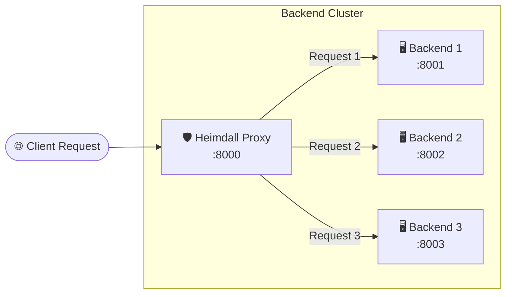

# 🛡️ Heimdall - Async HTTP Load Balancer

<p align="center">
  
  
  
  
</p>

> *"Heimdall stands watch at the gates of the Bifröst, observing all that enters and guiding traffic safely across the realms."*

**Heimdall** is a lightweight, asynchronous reverse proxy and load balancer built with **FastAPI** and **HTTPX**. It intercepts incoming HTTP traffic and distributes requests across a pool of backend servers using the **Round-Robin** scheduling algorithm.

---

## ⚡ Architecture



---

## ✨ Features

- 🔄 **Round-Robin Load Balancing**: Even distribution of incoming requests across backend nodes.
- ⚡ **Fully Asynchronous**: Powered by FastAPI and `httpx.AsyncClient` for high throughput and non-blocking I/O.
- 🎯 **Transparent Proxying**: Forwards requests and seamlessly relays JSON responses back to clients.
- 🪶 **Zero-bloat & Minimalist**: Clean, understandable codebase ideal for learning or extending custom routing policies.

---

## 📁 Project Structure

```text
loadBalancer/
├── proxy.py          # Heimdall reverse proxy and load balancer logic
├── server.py         # Mock backend server application
├── .gitignore        # Git ignore configurations
└── README.md         # Documentation
```

---

## 🚀 Getting Started

### 1. Prerequisites

Ensure you have Python 3.9+ installed. Install the required dependencies:

```bash
pip install fastapi uvicorn httpx
```

---

### 2. Launch Backend Servers

Start multiple backend instances on different ports (e.g. `8001`, `8002`, `8003`):

```bash
# Terminal 1
uvicorn server:app --port 8001

# Terminal 2
uvicorn server:app --port 8002

# Terminal 3
uvicorn server:app --port 8003
```

---

### 3. Launch Heimdall Proxy

In another terminal, start the Heimdall load balancer on port `8000`:

```bash
uvicorn proxy:app --port 8000
```

---

## 🧪 Testing the Load Balancer

Send successive requests to Heimdall on port `8000`:

```bash
curl http://127.0.0.1:8000/
```

### Sample Output Sequence:

**Request 1:**
```json
{
  "message": "Success",
  "handled_by": "Server running on port 8001"
}
```

**Request 2:**
```json
{
  "message": "Success",
  "handled_by": "Server running on port 8002"
}
```

**Request 3:**
```json
{
  "message": "Success",
  "handled_by": "Server running on port 8003"
}
```

---

## 🔮 Roadmap

- [ ] 🩺 **Active Health Checks**: Automatic detection and ejection of unhealthy backend nodes.
- [ ] ⚖️ **Weighted Round-Robin & Least Connections**: Advanced traffic scheduling algorithms.
- [ ] 🔒 **TLS / SSL Termination**: Secure ingress traffic handling.
- [ ] 📊 **Metrics & Monitoring Dashboard**: Real-time stats for throughput, latency, and node health.

---

## 📄 License

Distributed under the MIT License.
