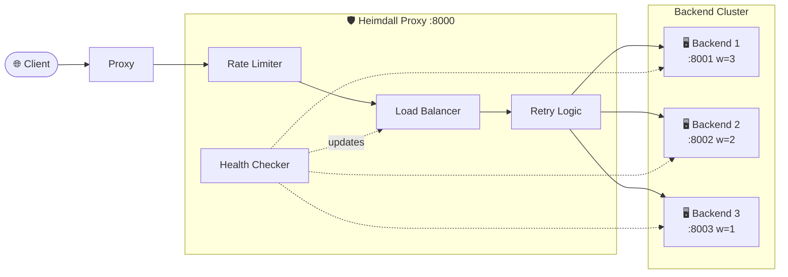

# 🛡️ Heimdall - Async HTTP Load Balancer

<p align="center">
  
  
  
  
</p>

> *"Heimdall stands watch at the gates of the Bifröst, observing all that enters and guiding traffic safely across the realms."*

**Heimdall** is a lightweight, asynchronous reverse proxy and load balancer built with **FastAPI** and **HTTPX**. It distributes incoming HTTP traffic across a pool of backend servers with support for multiple load balancing algorithms, active health checks, automatic failover, and per-IP rate limiting — all configured via a single YAML file.

---

## ⚡ Architecture



---

## ✨ Features

- 🔄 **Multiple Load Balancing Algorithms**
  - **Round-Robin**: Even, sequential distribution across backends.
  - **Weighted Round-Robin**: Proportional traffic distribution using the Smooth Weighted Round-Robin (SWRR) algorithm — avoids bursty routing.
  - **Least Connections**: Routes to the backend with the fewest in-flight requests — ideal for uneven processing times.
- 🩺 **Active Health Checks**: Background task pings each backend periodically. Unhealthy nodes are automatically ejected and restored on recovery.
- 🔁 **Automatic Retry**: If a backend fails mid-request, Heimdall retries on the next healthy backend (up to 3 attempts).
- 🎯 **Transparent Reverse Proxying**: Forwards **all HTTP methods** (GET, POST, PUT, DELETE, PATCH, HEAD, OPTIONS), preserving paths, query strings, headers, and request bodies.
- 🚦 **Per-IP Rate Limiting**: Sliding-window rate limiter prevents abuse, returning `429 Too Many Requests` with `Retry-After` headers.
- 📊 **Admin Endpoints**: Real-time visibility into backend health and per-backend request statistics.
- ⚙️ **YAML Configuration**: No hardcoded server lists — configure backends, algorithms, health checks, and rate limits in `config.yaml`.
- 📝 **Structured Logging**: Every proxied request is logged with method, path, target backend, status code, and latency.

---

## 📁 Project Structure

```text
loadBalancer/
├── config.yaml               # Backends, algorithm, health check & rate limit settings
├── proxy.py                   # Heimdall reverse proxy — the main entry point
├── server.py                  # Enhanced mock backend server for testing
├── requirements.txt           # Python dependencies
├── balancer/
│   ├── __init__.py
│   ├── algorithms.py          # Round-Robin, Weighted Round-Robin, Least Connections
│   ├── health.py              # Background health checker with auto-ejection
│   └── rate_limiter.py        # Per-IP sliding window rate limiter
├── .gitignore
└── README.md
```

---

## 🚀 Getting Started

### 1. Prerequisites

Python 3.9+ is required. Install dependencies:

```bash
pip install -r requirements.txt
```

### 2. Configure

Edit `config.yaml` to define your backend pool and preferences:

```yaml
backends:
  - url: "http://127.0.0.1:8001"
    weight: 3
  - url: "http://127.0.0.1:8002"
    weight: 2
  - url: "http://127.0.0.1:8003"
    weight: 1

algorithm: "round-robin"  # round-robin | weighted-round-robin | least-connections

health_check:
  enabled: true
  interval_seconds: 10
  timeout_seconds: 3
  unhealthy_threshold: 3
  endpoint: "/health"

rate_limit:
  enabled: true
  max_requests: 50
  window_seconds: 60
```

### 3. Launch Backend Servers

Start multiple backend instances on different ports:

```bash
# Terminal 1
uvicorn server:app --port 8001

# Terminal 2
uvicorn server:app --port 8002

# Terminal 3
uvicorn server:app --port 8003
```

### 4. Launch Heimdall

```bash
uvicorn proxy:app --port 8000
```

---

## 🧪 Usage Examples

### Basic Load Balancing (Round-Robin)

```bash
# Successive requests are distributed across backends
curl http://127.0.0.1:8000/
curl http://127.0.0.1:8000/
curl http://127.0.0.1:8000/
```

```json
{"message":"Success","handled_by":"Server running on port 8001","timestamp":1723456789.0}
{"message":"Success","handled_by":"Server running on port 8002","timestamp":1723456790.0}
{"message":"Success","handled_by":"Server running on port 8003","timestamp":1723456791.0}
```

### POST Body Proxying

```bash
curl -X POST http://127.0.0.1:8000/echo \
  -H "Content-Type: application/json" \
  -d '{"key": "value"}'
```

```json
{
  "handled_by": "Server running on port 8001",
  "echoed_body": {"key": "value"},
  "content_type": "application/json"
}
```

### Path Parameter Proxying

```bash
curl http://127.0.0.1:8000/items/1
```

```json
{
  "handled_by": "Server running on port 8002",
  "item_id": 1,
  "name": "Mjölnir",
  "type": "weapon"
}
```

### Admin — Backend Health

```bash
curl http://127.0.0.1:8000/_heimdall/health
```

```json
{
  "algorithm": "round-robin",
  "backends": [
    {"url": "http://127.0.0.1:8001", "weight": 3, "healthy": true, "consecutive_failures": 0},
    {"url": "http://127.0.0.1:8002", "weight": 2, "healthy": true, "consecutive_failures": 0},
    {"url": "http://127.0.0.1:8003", "weight": 1, "healthy": false, "consecutive_failures": 3}
  ]
}
```

### Admin — Request Statistics

```bash
curl http://127.0.0.1:8000/_heimdall/stats
```

```json
{
  "stats": [
    {"url": "http://127.0.0.1:8001", "total_requests": 42, "total_failures": 0, "avg_latency_ms": 12.5},
    {"url": "http://127.0.0.1:8002", "total_requests": 38, "total_failures": 1, "avg_latency_ms": 15.3},
    {"url": "http://127.0.0.1:8003", "total_requests": 20, "total_failures": 3, "avg_latency_ms": 8.7}
  ]
}
```

---

## ⚙️ Load Balancing Algorithms

| Algorithm | Best For | How It Works |
|---|---|---|
| `round-robin` | Equal-capacity backends | Cycles through backends sequentially |
| `weighted-round-robin` | Mixed-capacity backends | Uses SWRR to distribute traffic proportionally by weight without bursts |
| `least-connections` | Variable processing times | Routes to the backend with the fewest active in-flight requests |

Switch algorithms by changing the `algorithm` field in `config.yaml` — no code changes needed.

---

## 🔮 Roadmap

- [ ] 🔒 **TLS / SSL Termination**: Secure ingress traffic handling.
- [ ] 📊 **Monitoring Dashboard**: Web UI for real-time throughput, latency, and node health visualization.
- [ ] 🌐 **WebSocket Proxying**: Support for persistent WebSocket connections.
- [ ] 🐳 **Docker Compose Setup**: One-command deployment of the full stack.

---

## 📄 License

Distributed under the MIT License.
